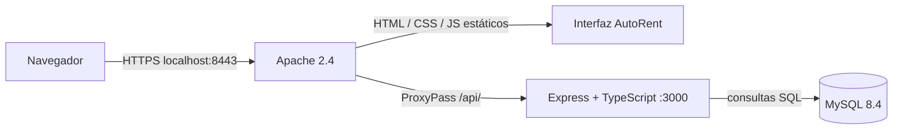

# AutoRent — Proyecto de Cátedra, Fase 2

Base funcional del sitio de alquiler de vehículos de **Rent a Car Molina**. Entrega: **11 de noviembre de 2026, 23:59 (El Salvador)**.

**Equipo:** Dereck Enrique Ventura Benítez, Andersson Wilfredo Vargas Reyes, Luis Román Lino Merino y Edwin David Díaz Acosta.

## Arquitectura



Apache termina TLS y sirve la interfaz compilada. `ProxyPass` y `ProxyPassReverse` reenvían `/api/` a `http://api:3000/api/`; también se reenvían `/media/` y `/health`. Una sola instancia Express procesa las consultas del negocio. La API y MySQL no publican puertos del host; MySQL permanece en una red interna. `TRUST_PROXY_HOPS=1` corresponde al único proxy Apache.

La configuración está en [httpd.conf](infra/apache/httpd.conf) y [compose.yaml](compose.yaml). Referencia: [ProxyPass de Apache](https://httpd.apache.org/docs/2.4/mod/mod_proxy.html#proxypass).

## Relación con la Clase 19 (blog.local)

Se revisó el material de Clase 19 aportado por el equipo y su [repositorio base](https://github.com/manasesortez/blog.local.api), revisión `7d1bfb049049197581dcf11c308c9a27fb87553a`. La adaptación directa de `src/index.ts` está en [clase19.routes.ts](backend/src/routes/clase19.routes.ts): conserva Express/TypeScript, el controlador GET con respuesta JSON y `/info` personalizado. Las consultas `/articulos` y `/articulos/:id` se transformaron en `/api/vehiculos` y `/api/vehiculos/:id`, con validación, filtros y persistencia MySQL del negocio. El arranque se separa en `server.ts` y la aplicación en `app.ts`.

El puerto interno se unifica en 3000. Docker Compose gestiona el proceso en esta instalación, en lugar de NSSM/systemd. Apache sirve los estáticos y reenvía solo las rutas dinámicas como en la clase; se agrega HTTPS. El PDF de clase se conserva localmente como referencia académica.

## Iniciar en Windows

Requisitos: Docker Desktop con el motor iniciado y Git para Windows (incluye OpenSSL). Node.js 24 se utiliza dentro de las imágenes; no es necesario instalarlo en Windows para ejecutar la entrega.

```powershell
git clone https://github.com/DereckVentura/gsw_Proyect.git
cd gsw_Proyect
.\INICIAR.cmd
```

El iniciador genera `.env` con secretos aleatorios, crea el certificado local en `.local/certs/` y construye los servicios. MySQL se inicializa con las migraciones y la flota del proyecto si está vacío. Abrir **https://localhost:8443** después de configurar la confianza del certificado.

### HTTPS sin advertencias

El certificado autofirmado se genera para `localhost` y `127.0.0.1`, con vigencia de un año. En cada computadora se debe confiar explícitamente en su propio certificado público. Desde PowerShell, después de iniciar:

```powershell
Get-PfxCertificate .local/certs/localhost.crt | Format-List Subject,Thumbprint
Import-Certificate -FilePath .local/certs/localhost.crt -CertStoreLocation Cert:\CurrentUser\Root
```

Verificar que sea el certificado generado por esta instalación. Cerrar y volver a abrir el navegador si conserva un estado anterior. Abrir `https://localhost:8443` y consultar la información del sitio: debe indicar **La conexión es segura**. En navegadores Chromium actuales el candado aparece dentro de ese panel, al abrir el icono de controles junto a la dirección. No se necesita omitir advertencias ni desactivar la validación TLS.

La llave privada `.local/certs/localhost.key`, `.env` y los certificados locales están excluidos de Git. Cada equipo genera los suyos.

## Demostración de la API del negocio

- [Catálogo de vehículos](https://localhost:8443/api/vehiculos): devuelve vehículos, tarifas, fotografías y paginación desde MySQL.
- [Detalle del vehículo 1](https://localhost:8443/api/vehiculos/1): consulta dinámica por identificador; devuelve 404 si no existe.
- [Filtro por precio máximo](https://localhost:8443/api/vehiculos?precio_max=60): filtra el catálogo en el servidor.
- [Información personalizada](https://localhost:8443/api/info).
- [Salud de base de datos](https://localhost:8443/api/v1/health/database).

La interfaz conserva sus rutas `/api/v1/vehicles`, `/api/v1/catalogs` y las funciones existentes del negocio. Los datos del laboratorio están separados del servicio de producción; el kilometraje inicial de 50000 y los puntos de entrega son ilustrativos. Usar cuentas y documentos ficticios en pruebas.

## Comprobar y detener

```powershell
docker compose ps
docker compose exec apache httpd -t
powershell -ExecutionPolicy Bypass -File scripts/verificar-fase2.ps1
curl.exe https://localhost:8443/api/vehiculos
docker compose logs --tail 20 apache api
docker compose down
```

`down` conserva el volumen de MySQL. Para reiniciar, ejecutar `INICIAR.cmd`. Para revisar una petición en ambas capas, consultar `/api/vehiculos` y buscar esa ruta en los registros de Apache y Express.

Para desarrollo local con Node.js 24: en `backend`, ejecutar `npm ci`, `npm run typecheck`, `npm test`, `npm run build`; en `web`, ejecutar `npm ci`, `npm run typecheck`, `npm run build`.

**Pendiente para completar la rúbrica:** adjuntar las capturas reales del navegador con la conexión segura. El procedimiento está en `evidencias/README.md`.

## Contenido de la entrega

| Requisito | Archivos o evidencia |
| --- | --- |
| Express/TypeScript y ruta del negocio | `backend/src/`, `database/`, `Dockerfile` |
| Apache y reverse proxy directo | `infra/apache/`, `compose.yaml` |
| HTTPS y capturas reales del navegador | [Evidencias](evidencias/README.md) |
| Instalación y arquitectura | Este README |

Esta entrega utiliza una instancia de Express. Los documentos extensos, guiones, herramientas de generación, configuraciones de clúster y balanceador de fases posteriores se conservan en la carpeta de trabajo local, excluidos de esta versión del repositorio.
