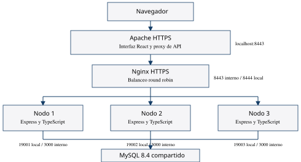

# AutoRent para Gestión de Servidores Web

Proyecto de alquiler de vehículos de Rent a Car Molina. Entrega del **11 de noviembre de 2026**, con material de clase recibido hasta la clase 32. Tema y equipo de cuatro integrantes aprobados por el docente.

**Integrantes:** Dereck Enrique Ventura Benítez, Andersson Wilfredo Vargas Reyes, Luis Román Lino Merino y Edwin David Díaz Acosta.

## Entrega

- [Documentación integral](entrega_2026-11-11/Documentacion_integral_AutoRent.pdf): requisitos, análisis, diseño, plan de pruebas, manuales, calidad, seguridad, capacitación y acta.
- [Arquitectura de tres nodos](entrega_2026-11-11/Arquitectura_AutoRent.pdf).
- [Manual corto de reserva](entrega_2026-11-11/Manual_corto_reserva.pdf).
- [Explicación para cuatro personas](entrega_2026-11-11/Guion_cuatro_personas.pdf).
- [Acta de verificación](documentacion/Acta_verificacion.md) y [evidencias](evidencias/).

## Iniciar en Windows

Se necesitan Docker Desktop con su motor iniciado y Git para Windows. En la primera ejecución hay descargas de imágenes oficiales.

1. Obtener el repositorio con `git clone https://github.com/DereckVentura/gsw_Proyect.git`.
2. Abrir la carpeta y ejecutar `INICIAR.cmd`.
3. Para comprobar manualmente: `docker compose ps`.
4. Abrir **https://localhost:8443**. El certificado es local y autofirmado; revisar su identidad y el procedimiento de confianza descrito en el manual de instalación.

La preparación genera secretos aleatorios y un certificado solo en `.env` y `.local/`. Esos archivos no se publican. MySQL conserva los datos en un volumen. `docker compose down` detiene el laboratorio conservando ese volumen; no usar la opción de borrar volúmenes como apagado habitual.

## Arquitectura

Navegador → Apache HTTPS → Nginx HTTPS → nodo1, nodo2 y nodo3 con Express/TypeScript → MySQL 8.4 compartido.

Apache sirve la interfaz React adaptada de AutoRent. Las rutas `/api/`, `/health` y `/media/` pasan al balanceador. La web pública original usa Cloudflare D1; esta instalación académica utiliza Express y MySQL y no comparte las cuentas ni reservas de producción.

| Dirección local | Uso |
| --- | --- |
| https://localhost:8443 | Aplicación por Apache |
| https://localhost:8444/health | Balanceador para diagnóstico |
| http://localhost:19001/health | Nodo 1 |
| http://localhost:19002/health | Nodo 2 |
| http://localhost:19003/health | Nodo 3 |

Los puertos se enlazan solo a la dirección local y MySQL no publica su puerto. La red de API y base está aislada. La demostración de réplicas no elimina los puntos únicos de falla de la computadora, la base o los puntos de entrada.

## Salud y recuperación

Ejecutar `powershell -File scripts/verificar-cluster.ps1`. Para la práctica: detener una instancia con `docker compose stop nodo2`, repetir la consulta de salud y verificar atención por el balanceador. Recuperar con `docker compose start nodo2`.

La ruta `/health` consulta MySQL y devuelve la identidad del nodo. `?simular=falla` devuelve 503 si la simulación está habilitada, sin detener el proceso. Nginx aplica comprobación pasiva; Docker no reinicia un contenedor únicamente por marcarlo como no saludable.

## Desarrollo

En `backend`: `npm ci`, `npm run typecheck`, `npm test` y `npm run build`. En `web`: `npm ci`, `npm run typecheck` y `npm run build`. El backend requiere Node.js 24; los archivos lock fijan las dependencias.

La carpeta `database/migrations` contiene el esquema. El inicializador se limita a `autorent_gsw`, aplica migraciones y carga una flota inicial si la base está vacía. El kilometraje de 50000 y las direcciones de entrega de la base académica son ilustrativos. Usar únicamente cuentas e imágenes de licencia ficticias en pruebas.

## Documentación y autoría

Los Markdown de `documentacion` son editables. El generador de PDF está en `tools/generar_documentacion.py`. Se adaptó la organización de Documentación de Software I y la presentación académica del ejemplo aportado; las referencias IEEE son orientación de clase y no una certificación. El código de base y la marca AutoRent fueron aportados por el equipo; las bibliotecas conservan sus licencias respectivas.
