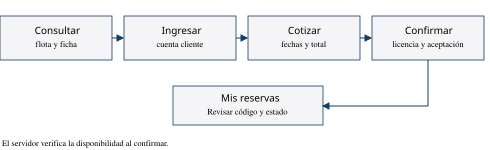
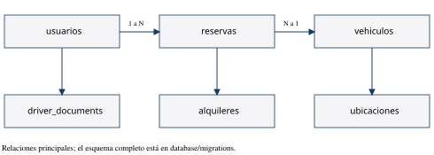

# Capítulo 2 Análisis funcional

## 2 1 Procesos del negocio

El catálogo es la entrada a la aplicación. El cliente identifica la unidad y elige un período de alquiler. La cotización se calcula en el servidor para evitar que la interfaz determine el precio final. Antes de guardar la reserva se vuelven a validar la tarifa, la disponibilidad y los requisitos del conductor.

La creación de una reserva bloquea los registros necesarios dentro de una transacción. Esta validación compartida en MySQL es la que permite coordinar solicitudes que llegan a réplicas distintas. Una variable de memoria de un nodo no sustituye la información común.

## 2 2 Flujo de reserva

Una cotización no bloquea definitivamente una unidad. Si otro cliente reserva primero, la confirmación posterior debe devolver un conflicto. La interfaz informa ese resultado para que el cliente cambie las fechas.

## 2 3 Estados del alquiler

La reserva pasa de confirmada a en_curso cuando la administración registra la entrega y a completada cuando registra la devolución. Puede pasar a cancelada cuando se cumplen las condiciones de cancelación. El modelo también contempla no_presentado; la existencia del estado no implica que haya una asignación automática.

Una unidad puede estar operativa, en mantenimiento o inactiva. Publicar una unidad es una decisión diferente de declarar que está libre durante unas fechas. El servidor debe evaluar estado y reservas al confirmar.

## 2 4 Modelo de información

| Entidad | Función y relaciones principales |
| --- | --- |
| usuarios | Identidad, contraseña procesada y rol; un usuario tiene varias reservas |
| categorias, marcas y modelos | Clasificación de vehículos; cada modelo pertenece a una marca |
| vehiculos | Unidad de flota con tarifa, estado, fotografías y ubicación |
| ubicaciones | Sucursales o puntos de entrega y devolución |
| reservas | Período, cliente, vehículo, precio y estado de la contratación |
| alquileres | Salida y devolución efectiva asociadas a una reserva |
| driver_documents | Licencia aportada y sus imágenes privadas, vinculadas al usuario |
| notificaciones | Avisos internos para el usuario |
| audit_events y api_rate_limits | Registro de operaciones y límites compartidos de acceso |
| tablas de contenido y aceptación | Versiones de documentos y constancias de aceptación |

El detalle normativo del esquema se conserva en database/migrations. La base utiliza InnoDB, claves foráneas y restricciones. Las migraciones se ejecutan una vez por versión y conservan una huella del archivo aplicado.

## 2 5 Reglas de negocio

Las fechas se interpretan con un inicio incluido y un fin excluido. Dos períodos contiguos pueden compartir la hora límite; dos períodos que se solapan no pueden confirmar la misma unidad. Las cantidades monetarias se calculan con las reglas de precisión del servidor y los bloques de 24 horas iniciados se cobran como días.

La sesión identifica al usuario, pero el rol vigente se obtiene nuevamente de MySQL. El registro público no permite crear administradores. La consulta del historial debe comprobar propiedad o permiso administrativo.

La licencia debe estar vigente durante el período exigido por el sistema y su consulta debe limitarse al titular y a la administración autorizada. En el laboratorio se usarán exclusivamente documentos ficticios.
