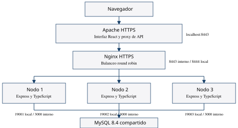

# Capítulo 3 Diseño del software y del despliegue

## 3 1 Arquitectura del laboratorio

Apache sirve la interfaz React compilada y reenvía las rutas de API y de fotografías hacia Nginx por HTTPS. Nginx distribuye las solicitudes entre nodo1, nodo2 y nodo3. Las tres API usan MySQL 8.4, que mantiene la información compartida en un volumen persistente.

La interfaz procede del código AutoRent aportado por el equipo. Se preparó como aplicación estática y se adaptó el envío de la licencia al contrato JSON de Express. Esta copia académica utiliza MySQL; el sitio público original conserva su implementación Cloudflare D1 y constituye una instalación separada.

## 3 2 Componentes y puertos

| Componente | Puerto y acceso | Responsabilidad |
| --- | --- | --- |
| Apache | https://localhost:8443 y redirección desde 8088 | Entrada del usuario y contenido web |
| Nginx | 8443 interno; https://localhost:8444 para diagnóstico | Balanceo de las solicitudes dinámicas |
| nodo1 | 3000 interno; localhost:19001 para diagnóstico | Réplica Express |
| nodo2 | 3000 interno; localhost:19002 para diagnóstico | Réplica Express |
| nodo3 | 3000 interno; localhost:19003 para diagnóstico | Réplica Express |
| MySQL | 3306 interno, sin puerto publicado | Estado compartido y persistencia |

Las publicaciones de puertos se limitan a 127.0.0.1. El laboratorio no queda expuesto a otros equipos de la red por defecto. La red clusternet está declarada como interna. Una exposición para una prueba cruzada exige revisar dirección, firewall y acceso al entorno de prueba.

## 3 3 Diseño de la API

routes declara rutas y permisos; controllers transforma HTTP en llamadas; validators comprueba entradas; services organiza reglas y autenticación; repositories ejecuta consultas; config valida el entorno y el acceso a MySQL. Las dependencias se fijan en package-lock.json.

| Interfaz | Comportamiento |
| --- | --- |
| GET /health | Comprueba MySQL e informa estado, nodo y hora |
| GET /api/v1/health | Comprueba que el proceso responde |
| GET /api/v1/health/database | Comprueba la dependencia MySQL |
| GET /api/v1/vehicles | Consulta catálogo y filtros |
| GET /api/v1/vehicles/:id/availability | Devuelve los períodos de ocupación |
| POST /api/v1/reservations/quote | Cotiza un período válido para un cliente autenticado |
| POST /api/v1/reservations | Confirma una reserva validada y admite clave de idempotencia |

Cada API agrega la cabecera X-AutoRent-Node. La ruta /health identifica la instancia en el cuerpo. La simulación mediante ?simular=falla está condicionada a ENABLE_FAILURE_SIMULATION=true y devuelve 503 solo para esa solicitud; no detiene un proceso ni cambia globalmente su salud.

## 3 4 Continuidad y estado compartido

Nginx usa round robin y comprobación pasiva de errores de conexión o respuestas configuradas. Los healthchecks de Docker y el script verificador permiten observar el estado por URL. La directiva activa health_check no se usa, porque pertenece a Nginx Plus. Un estado unhealthy no reinicia automáticamente el contenedor.

La configuración no habilita el reenvío de escrituras no idempotentes ya enviadas. La clave de idempotencia de reservas se conserva para controlar reintentos autorizados. Las réplicas usan la misma clave JWT y la misma base.

El laboratorio demuestra redundancia de las instancias de la API. Apache, Nginx, MySQL y la computadora anfitriona siguen siendo puntos únicos de falla. Las tres réplicas de Express no forman un sistema de elección de líder ni implementan quórum por sí mismas.

## 3 5 Decisiones y límites

Se adopta Node.js 24 por compatibilidad con el backend existente; la imagen Node 22 de la práctica es una referencia de clase. MySQL se conserva para reutilizar el modelo y las transacciones. Los certificados locales cifran la entrada y el enlace Apache a Nginx; las comunicaciones internas entre Nginx y Express y entre Express y MySQL se realizan en la red Docker privada del laboratorio.

La disponibilidad de 99.9 % es un objetivo de diseño. Su medición requiere un período de observación definido. La cantidad de nodos de la práctica no es una medición de demanda real ni garantiza tolerancia a una falla de la computadora.
