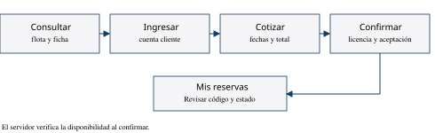

# Capítulo 5 Manual de usuario

## 5 1 Identificación y propósito

Manual de usuario de AutoRent, versión documental 1.0, entrega del 11 de noviembre de 2026. Dirigido a visitantes y clientes que consultan o reservan vehículos. La copia académica se abre en https://localhost:8443 después de que el operador inicia el laboratorio. La web pública del negocio se encuentra en la dirección indicada en las referencias.

Las instrucciones describen controles de la interfaz AutoRent. En el laboratorio se deben utilizar datos ficticios; el kilometraje y los puntos de entrega demostrativos no acreditan condiciones de un alquiler real. La instalación de servidores corresponde al capítulo 6 y no es una tarea del cliente.

## 5 2 Concepto de operaciones

El usuario consulta la flota sin iniciar sesión. Para reservar debe ingresar o registrarse, seleccionar fechas y revisar la cotización. La confirmación se realiza después de aportar el documento requerido y aceptar las condiciones. La reserva aparecerá en Mis reservas cuando el servidor confirme que fue guardada.

## 5 3 Consultar y filtrar vehículos

1. Abra AutoRent y seleccione Nuestra flota.
2. Revise las unidades que aparecen en el catálogo.
3. Utilice Marca, Color y Disponibilidad para reducir los resultados.
4. Abra el detalle del vehículo para consultar sus fotografías y características.
5. Si no aparecen unidades, quite los filtros y vuelva a consultar.

Una ficha con datos por confirmar debe interpretarse de esa forma. La existencia de una fotografía o de un año publicado no sustituye la revisión documental del vehículo.

## 5 4 Crear cuenta e ingresar

1. Seleccione Ingresar.
2. Si no tiene cuenta, elija la opción de registro de la ventana.
3. Complete los campos solicitados y revise los documentos mostrados.
4. Marque las aceptaciones correspondientes y envíe el formulario.
5. Para ingresar con una cuenta existente, utilice el correo y la contraseña registrados.

No se debe compartir la contraseña. Si la sesión vence, ingrese nuevamente. El sistema no ofrece recuperación automática de contraseña en este alcance.

## 5 5 Cotizar y reservar

1. Ingrese con una cuenta de cliente y abra la unidad deseada.
2. Seleccione la opción para reservar.
3. Espere a que se cargue la disponibilidad y elija inicio y final del alquiler.
4. Seleccione los puntos de entrega y devolución.
5. Solicite la cotización y revise vehículo, fechas, tarifa y total.
6. Adjunte las dos caras de la licencia y complete los datos solicitados. En la demostración use imágenes ficticias.
7. Revise el aviso de privacidad y las condiciones, y marque sus aceptaciones.
8. Confirme la reserva una sola vez y espere la respuesta.
9. Abra Mis reservas y compruebe el código y el estado de la operación.

La cotización no garantiza que la unidad continúe libre hasta confirmar. Si aparece un conflicto, cambie las fechas y solicite una cotización nueva.

## 5 6 Consultar y cancelar

1. Seleccione Mis reservas después de ingresar.
2. Identifique la operación mediante su código y sus fechas.
3. Revise el estado antes de solicitar una cancelación.
4. Cuando la opción esté disponible, seleccione Cancelar y revise la confirmación de la pantalla.
5. Compruebe el estado actualizado. Si la operación ya inició o las condiciones no permiten cancelar, siga el mensaje del sistema y contacte a la administración.

## 5 7 Mensajes y solución de dificultades

| Mensaje o situación | Qué debe hacer el usuario |
| --- | --- |
| Correo o contraseña incorrectos | Revise los datos y vuelva a ingresar |
| Sesión inválida o vencida | Ingrese nuevamente |
| Espere a que cargue la disponibilidad | Mantenga abierta la ventana y reintente si aparece un error |
| Fechas ocupadas o conflicto de reserva | Seleccione otro período y cotice de nuevo |
| Licencia no vigente o imagen inválida | Revise vencimiento, formato y ambas caras; máximo 3 MB por imagen |
| Tarifa o documentos cambiaron | Revise la información nueva y vuelva a confirmar sus aceptaciones |
| Servicio o base no disponible | Espere y vuelva a consultar; avise al operador si persiste |
| No tiene permiso para esta acción | Use la función correspondiente a su cuenta y contacte a administración si procede |

## 5 8 Glosario y navegación

Flota es el conjunto de vehículos publicados. Cotización es el cálculo previo del alquiler. Disponibilidad indica si una unidad puede reservarse durante un período. Reserva confirmada es la operación guardada por el servidor. Sesión es el acceso temporal asociado a una cuenta.

Las opciones Nuestra flota, Mis reservas y Ubicaciones permiten cambiar de sección. Las ventanas se cierran con su control de cierre o con Escape. El índice del documento permite localizar los procedimientos; las rutas técnicas se encuentran en el capítulo 3.
