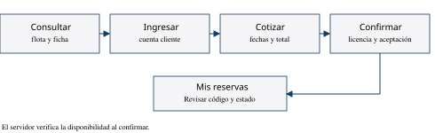

# Manual corto para reservar un vehículo

AutoRent · versión documental 1.0 · 11 de noviembre de 2026

Autores: Dereck Enrique Ventura Benítez, Andersson Wilfredo Vargas Reyes, Luis Román Lino Merino y Edwin David Díaz Acosta.

## Introducción

Esta guía está dirigida al cliente que desea cotizar y confirmar un alquiler en AutoRent. Describe una reserva y la comprobación de su registro. Se necesita acceso a la aplicación y una cuenta cliente. En el laboratorio se utilizarán datos y documentos ficticios.

## Concepto de operaciones

El cliente elige una unidad, cotiza un período y confirma sus requisitos. El servidor comprueba nuevamente la disponibilidad antes de guardar. Una cotización por sí sola no constituye una reserva.

## Procedimiento

1. Abra AutoRent y seleccione Ingresar. Utilice una cuenta cliente o complete el registro.
2. En Nuestra flota, abra el vehículo y seleccione la opción de reserva.
3. Espere a que cargue la disponibilidad. Elija las fechas y los puntos de entrega y devolución.
4. Solicite la cotización y revise unidad, fechas, tarifa y total.
5. Adjunte ambas caras de la licencia y complete sus datos. Utilice imágenes ficticias en la práctica.
6. Lea el aviso de privacidad y las condiciones y marque sus aceptaciones.
7. Confirme una sola vez y espere la respuesta. Abra Mis reservas y compruebe el código y el estado.

<!-- page -->

## Mensajes de error y solución

| Situación | Acción recomendada |
| --- | --- |
| Sesión vencida o credenciales incorrectas | Revise los datos e ingrese nuevamente |
| No cargó la disponibilidad | Espere o reintente antes de seleccionar fechas |
| Período ocupado | Seleccione otras fechas y solicite una cotización nueva |
| Licencia vencida o imagen inválida | Revise vencimiento y ambas imágenes; JPG, PNG o WebP, hasta 3 MB cada una |
| Tarifa o documentos cambiaron | Revise la información actualizada y vuelva a cotizar o aceptar |
| Servicio no disponible | Espere y vuelva a consultar; avise al operador si persiste |

## Glosario

**Flota.** Conjunto de vehículos publicados por el negocio.

**Cotización.** Cálculo previo del costo del alquiler para las fechas elegidas.

**Disponibilidad.** Posibilidad de reservar una unidad durante un período.

**Reserva confirmada.** Operación registrada después de que el servidor verifica sus requisitos.

## Reflexión sobre la documentación

La mayor dificultad de describir una reserva consiste en distinguir entre consultar, cotizar y confirmar. Cada paso tiene un efecto diferente y debe explicarse con claridad. Un manual útil indica cómo comprobar el resultado y qué hacer ante un conflicto, además de señalar qué botón debe utilizarse.

## Fuentes relacionadas

Documentación de Software I, material facilitado por el equipo. Manual completo de AutoRent, capítulo 5. Interfaz y contrato de reservas de la copia académica del proyecto. La figura es un diagrama del procedimiento, no una captura de pantalla.
